# Designer Blog

[](LICENSE)
[](https://adoptium.net/temurin/releases/)
[](https://solon.noear.org/)
[](https://vuejs.org/)

一套**前后台分离**的个人博客系统：博客前台（Vue 3 + Vite）面向读者，管理后台复用
**[Designer Admin](https://gitee.com/rainterm/designer-admin)** 脚手架（Solon + MyBatis-Plus + Vue 3 + Naive UI），
博客业务以独立模块 `designer-module-blog` 接入，**不改动**脚手架既有能力（改动清单见[相对上游的改动](#相对上游的改动)）。

**网站前台**：文章 / 分类 / 标签 / 评论 / 个人链接 / 访问统计；
**管理后台**：在同一套 RBAC、操作日志、定时任务、文件存储之上管理博客内容。

## 目录

- [界面预览](#界面预览)
- [功能特性](#功能特性)
- [技术栈](#技术栈)
- [目录结构](#目录结构)
- [快速开始（本地开发）](#快速开始本地开发)
- [后台能力（脚手架自带）](#后台能力脚手架自带)
- [生产环境部署（Docker）](#生产环境部署docker)
- [文档](#文档)
- [常见问题（FAQ）](#常见问题faq)
- [Roadmap](#roadmap)
- [致谢与上游](#致谢与上游)
- [贡献与反馈](#贡献与反馈)
- [许可证](#许可证)

## 界面预览

### 前端

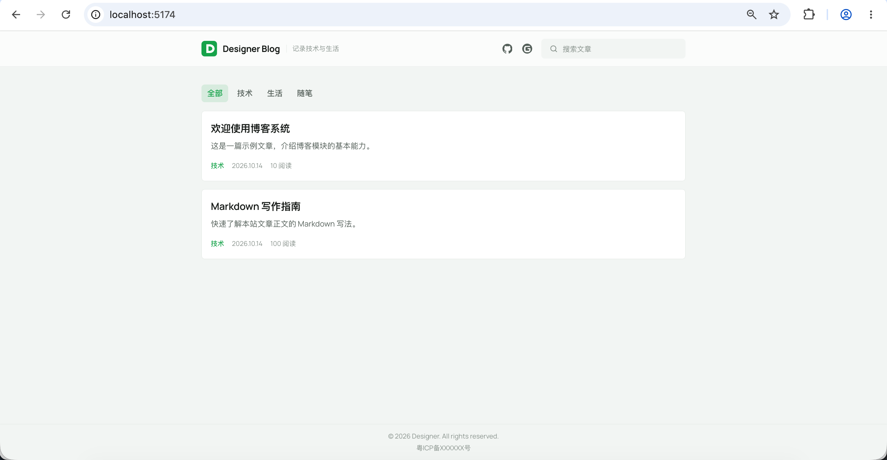

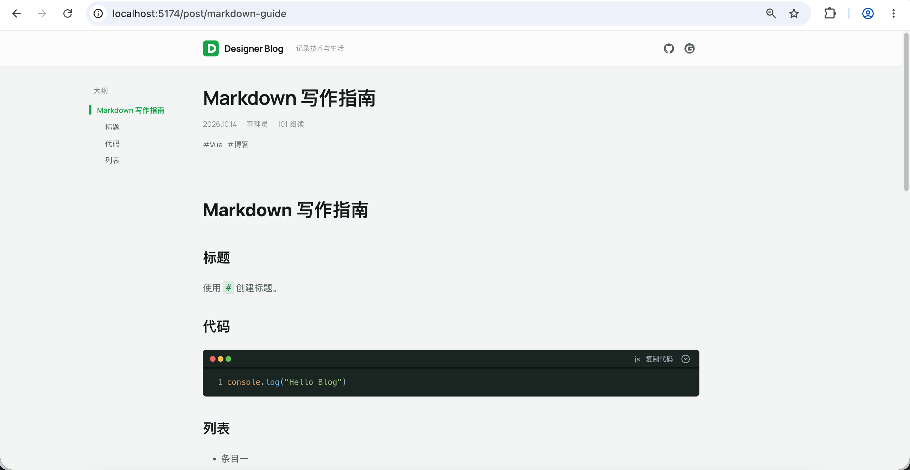

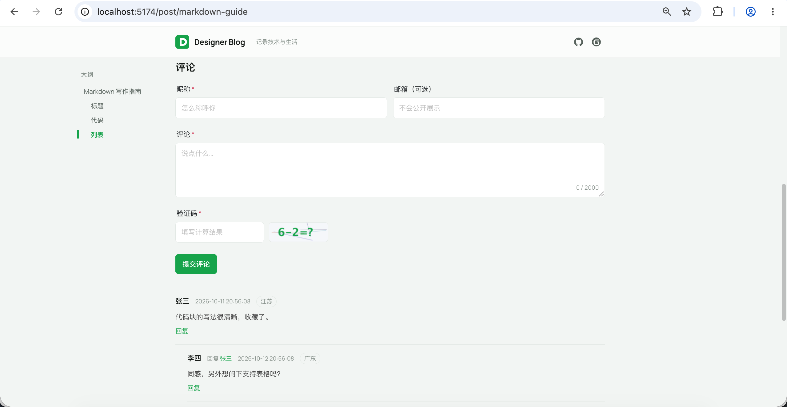

### 后台管理

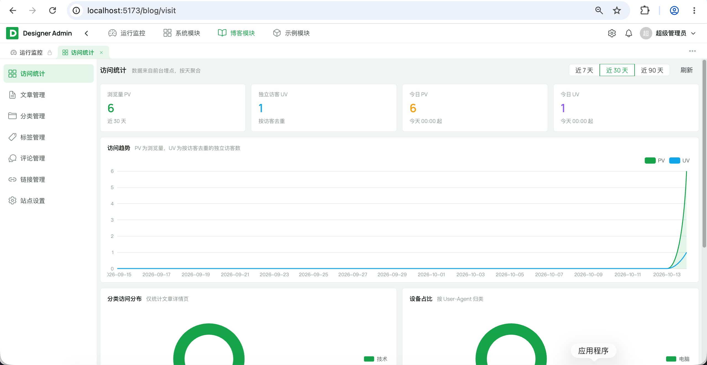

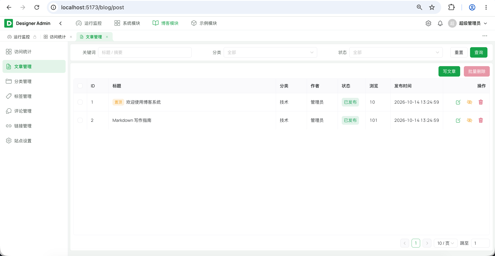

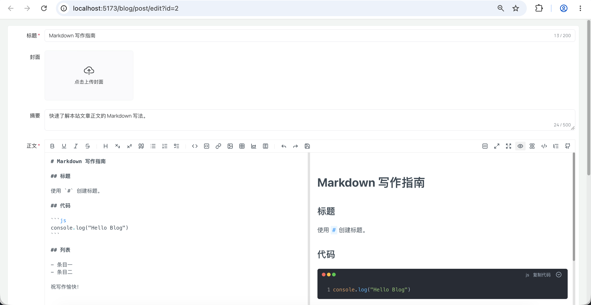

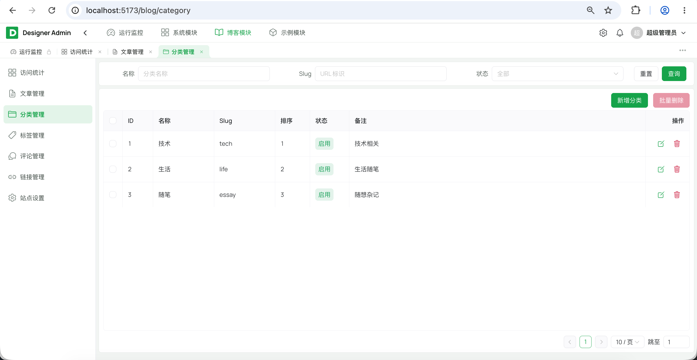

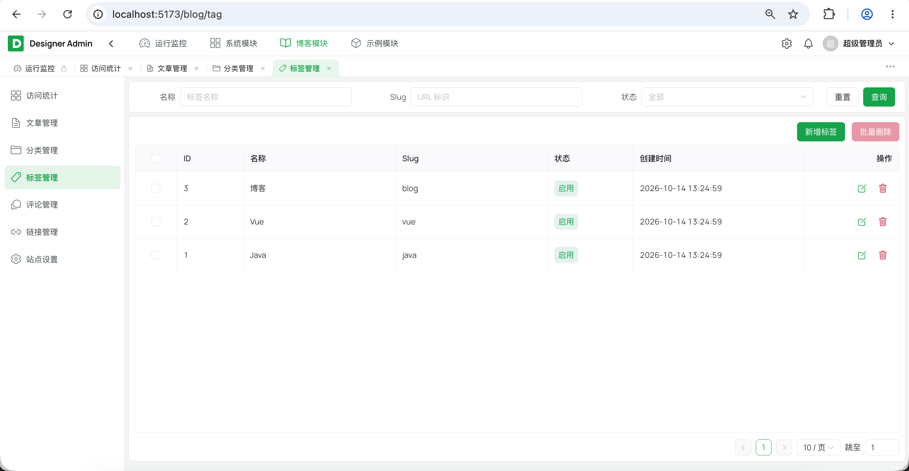

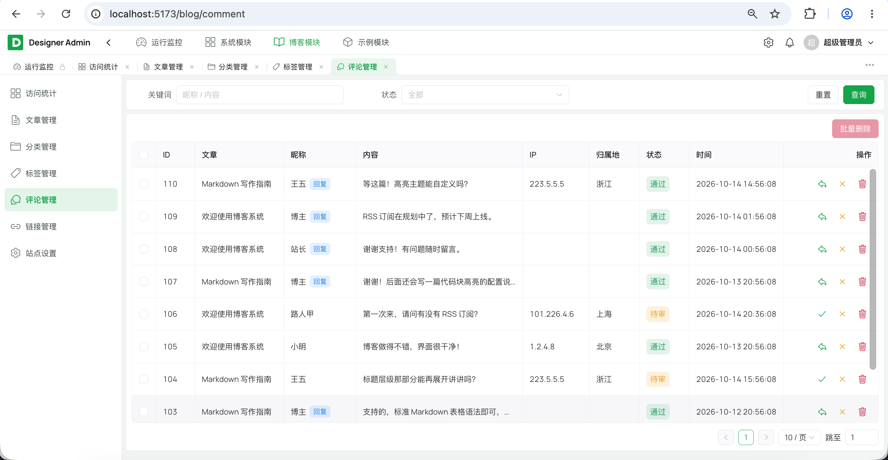

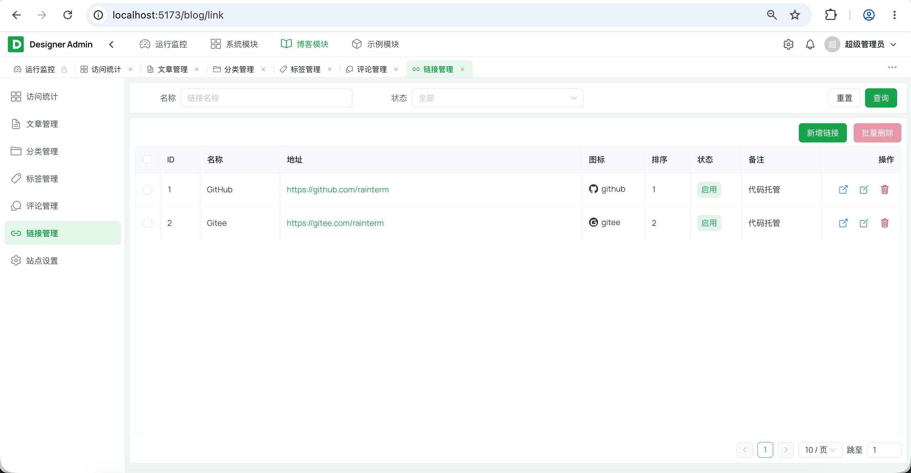

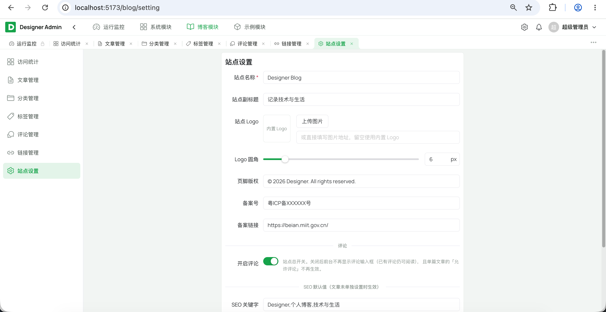

## 功能特性

### 内容

- **文章管理**：Markdown 正文（`md-editor-v3` 编辑器），草稿 / 发布两态，slug 作为前台地址（`/post/{slug}`）
- **分类与标签**：多对多标签（`blog_post_tag`），分类与标签各有独立前台页（`/category/{slug}`、`/tag/{slug}`）
- **个人链接**：站长的社交 / 外部链接（如 GitHub、Gitee、邮箱），后台维护名称与图标、可排序与启停；前台页头以一行图标展示，点击新开标签页
- **站点设置**：站点名 / 副标题 / Logo / 页脚 / 备案号 / SEO 描述 / 关键词，一处配置前台全站生效

### 评论

- **匿名评论**：读者无需注册；提交默认**待审**，后台审核通过才公开
- **防刷**：图形验证码（一次性消费）+ 分 IP 频率限制（两次最小间隔 30 秒、24 小时最多 20 条、验证码每分钟最多拉取 20 次）
- **两级开关**：站点总开关（后台「站点设置」）与单篇开关（文章「允许评论」）为**与**关系，都开启才可评论；关闭后**已发布评论仍可读**
- **回复层级压平为 2 层**：存储上 `parent_id` 记录真实回复对象（链可任意深），展示层统一上溯到顶级评论，最多两层，第二层标出「某某 回复 某某」
- **我的评论**：读者凭浏览器本地密钥（请求头 `X-Commenter-Key`，服务端只存 SHA-256）查看自己的待审评论、并删除自己的评论
- **IP 归属地**：离线 ip2region 解析到**省级**，前台与后台均展示，不向第三方泄露访客 IP

### 访问统计

前台每次路由切换上报一次埋点，后台「访问统计」页聚合成图表。

- **埋点只接收路径**：IP / UA / 来源 / 设备 / 页面归属分类**全部由服务端从请求推导**，前端无法伪造统计
- **五类图表**：PV / UV 趋势（按天补齐空缺日期）、分类访问分布、来源 Top、设备占比、访客地域分布（Top 10 省份）
- **防刷与去重**：同访客同路径 60 秒去重、单 IP 每日 3000 条上限，超限静默丢弃
- **日志清理**：内置任务 `blogLogTask.cleanVisitLog(90)`（默认暂停），保留 90 天

### 安全

- **客户端 IP 防伪造**：默认只信任 `127.0.0.1/32, ::1/128, 172.16.0.0/12` 网段传来的 `X-Forwarded-For`，其余一律忽略，沿链**从右往左**取第一个不可信地址；CIDR 匹配只解析字面量、不触发 DNS
- **部署层配合**：server 端口只绑回环（不绕过 Nginx 直连）、Nginx 用**覆写**而非追加语义写 `X-Forwarded-For`

## 技术栈

后端为 **Solon 全家桶**：框架、校验、日志、JSON、鉴权、密码加密全部来自 Solon / Sa-Token 生态。

| 层 | 选型 | 版本 |
|---|---|---|
| 运行时 | JDK | 25 |
| 后端框架 | Solon | 4.1.0 |
| ORM | MyBatis-Plus（Solon 插件） | 3.5.17 |
| 多表查询 | MyBatis-Plus-Join | 1.5.9 |
| 鉴权 | Sa-Token（Solon 插件） | 1.46.0 |
| 密码加密 | Sa-Token 自带 BCrypt | 内置 |
| JSON | snack4 | Solon 4.x 内置 |
| 定时任务 | Quartz | 2.5.0 |
| 导入导出 | EasyExcel | 4.0.3 |
| IP 归属地 | ip2region（离线 xdb） | 随包 |
| 数据库 | MySQL | 8 |
| 缓存/会话 | Redis | 7 |
| 前台 / 后台框架 | Vue 3 | 3.5 |
| UI 组件库 | Naive UI | 2.45 |
| 构建 | Vite | 8 |
| 状态管理 | Pinia | 4 |
| Markdown 编辑器 | md-editor-v3 | 7 |
| 图表 | ECharts（管理后台） | 5.6 |

> `md-editor-v3` 底层依赖 Vditor 的运行时资源（lute 引擎 / 代码高亮 / 图标 / 语言包），
> 默认从 unpkg 动态拉取，内网或国内网络下易失败。`admin-web` 的 Vite 插件
> （`plugins/copyVditorAssets.js`）在启动 / 构建时把这些资源复制到 `public/vditor`，
> 编辑器因此**不依赖外部 CDN**。

## 目录结构

```
designer-blog/
├── pom.xml                         # Maven 父工程
├── designer-common/                # 通用：R / BaseEntity / 异常 / 工具 / 注解
├── designer-framework/             # 框架层与扩展接口（鉴权/日志/任务/存储/消息），禁止依赖 system
├── designer-module-system/         # RBAC 系统模块（system-api / -service）
├── designer-module-blog/           # 博客业务模块（blog-api / -service）
│   └── README.md                   #   ★ 评论防刷、访问统计、IP 防伪造等设计说明
├── designer-module-demo/           # 模块示例（demo-api / -service）
├── designer-server/                # 启动组装：DesignerApp + app.yml + Solon 胖包
│   └── src/main/resources/
│       ├── app.yml
│       └── ip2region.xdb           #   IP 归属地离线数据（约 11MB，随包）
├── designer-ui/                    # 前端工程
│   ├── admin-web/                  # 管理后台（Vue3 + Naive UI + ECharts）
│   ├── blog-web/                   # 博客前台（Vue3 + Vite）
│   └── sso-demo/                   # SSO 接入示例（Vue3 + Vite）
├── sql/
│   └── init/mysql/                 # 按模块文件夹分类的初始化 SQL
│       ├── 00-run-init.sh          # 入口：_base → system / blog / demo
│       ├── _base/database.sql      # 建库
│       └── system|blog|demo/       # {schema,data}.sql
├── docs/                           # 开发规范、SSO 文档
└── deploy/                         # Docker 部署
```

## 快速开始（本地开发）

### 0. 环境要求

| 组件 | 版本 | 说明 |
|---|---|---|
| JDK | **25+** | 后端编译与运行（`maven.compiler.release=25`） |
| Maven | 3.9+ | 后端构建 |
| Node.js | 18+（推荐 22） | 前端构建 |
| pnpm | 10.x | 前端包管理（`packageManager: pnpm@10.33.0`） |
| MySQL | 8 | 数据库 |
| Redis | 7 | Sa-Token 会话、验证码与限流计数（**必需**） |

> 一键检查 / 安装以上环境：`cd deploy && ./install-env.sh --check`（去掉 `--check` 即安装）。

### 1. 准备 MySQL 与 Redis

连接信息在 `designer-server/src/main/resources/app.yml`，已支持环境变量覆盖
（`DB_HOST/DB_PORT/DB_USER/DB_PASSWORD/DB_NAME`、`REDIS_HOST/REDIS_PORT/REDIS_PASSWORD/REDIS_DB`）。

### 2. 初始化数据库

> 脚本为**破坏性初始化**（`DROP TABLE` 重建 + 插入种子数据），仅首次或需要重置时执行，勿对有数据的库重复运行。

```bash
# 交互式：按提示输入连接信息，回车使用默认值（已用环境变量提供的项会跳过；数据库名默认 designer_blog，可自定义）
bash sql/init/mysql/00-run-init.sh

# 免交互（CI / 脚本）：直接通过环境变量传入
DB_HOST=127.0.0.1 DB_PORT=3306 DB_USER=root DB_PASSWORD=root DB_NAME=designer_blog bash sql/init/mysql/00-run-init.sh
```

### 3. 启动后端

在 IDE 里运行 `com.designer.admin.DesignerApp`（模块 `designer-server`），或命令行：

```bash
# 在仓库根目录
mvn -pl designer-server -am -DskipTests clean package
java -jar designer-server/target/designer-server.jar
```

默认监听 `http://localhost:8080`，健康检查 `GET /admin-api/system/health`。

### 4. 启动前端

> 需要 pnpm：`corepack enable pnpm`（Node 16.13+ 内置）或 `npm i -g pnpm`。

```bash
# 管理后台 → http://localhost:5173
cd designer-ui/admin-web
pnpm install
pnpm run dev

# 博客前台 → http://localhost:5174
cd designer-ui/blog-web
pnpm install
pnpm run dev
```

两个前端都把 `/admin-api`、`/app-api` 代理到 `http://localhost:8080`，无需额外配置跨域。

### 默认账号

**注意**：以下为初始化种子数据中的演示账号，仅用于本地体验；部署到生产环境前请务必修改密码或删除该账号。

| 账号 | 密码 | 角色 |
|---|---|---|
| admin | admin123 | 超级管理员（全部权限） |
| guest | guest123 | 普通用户（只读示例） |

### 接口前缀约定

| 端 | 前缀 | 鉴权 |
|---|---|---|
| 管理后台 | `/admin-api/{模块}/...` | 登录态 + 权限标识 |
| 公开前台 | `/app-api/{模块}/...` | 默认免登录（`@SaIgnore`） |
| 第三方开放 | `/open-api/...` | OAuth2 + Scope |

博客前台只用到 `/app-api/blog/public/**`，详见 [designer-ui/blog-web/README.md](designer-ui/blog-web/README.md)。

## 后台能力（脚手架自带）

博客功能建立在这些基础能力之上，全部来自 Designer Admin：

- **认证与权限**：Sa-Token 登录鉴权（会话存 Redis，可集群共享）、验证码与登录失败锁定；用户 - 角色 - 菜单三级 RBAC，按钮即权限标识（如 `blog:comment:audit`）；动态路由按权限注册
- **组织与基础数据**：用户、部门树、岗位、角色授权、数据字典、系统参数
- **文件与消息**：可插拔文件存储（本地 / S3 兼容，上传元数据落库）、站内信 SSE 通知
- **日志与监控**：操作日志（`@OperLog` 异步落库）、登录日志、服务监控（CPU / 内存 / JVM / 磁盘）、首页仪表盘
- **定时任务**：Quartz 动态任务 + 执行日志（访问日志清理任务即注册在此）
- **前端体验**：7 种布局与主题色实时切换、多页签、个人中心、EasyExcel 导入导出、`@Sensitive` 字段脱敏
- **统一规范**：响应体 `{code,msg,data}`、全局异常、分页封装、字段自动填充、逻辑删除、全表更新/删除防护

## 生产环境部署（Docker）

数据库与应用**分开**部署：本机用 JDK / Maven / Node 打包后，再打成运行镜像。
前端由**同一个 Nginx 容器**按域名分流托管博客前台与管理后台。

```bash
cd deploy
./install-env.sh          # 检查并安装 Docker / JDK 25 / Maven / Node
cp .env.example .env && vim .env
./deploy-db.sh            # 仅启动 MySQL + Redis（不自动建表）
cd .. && bash sql/init/mysql/00-run-init.sh && cd deploy   # 手动初始化数据库表（首次/重置）
./deploy-app.sh           # 父工程 Maven 打包 + 构建镜像 + 启动 Server / 前端 Nginx
```

可选：`./deploy-minio.sh` 一键起本地 MinIO（S3 兼容存储，`9000` / `9001`）。

浏览器访问（均走 80，需先把域名解析到服务器）：

- 博客前台 `http://www.rainterm.cn`
- 管理后台 `http://admin.rainterm.cn`

域名与端口在 `deploy/nginx/default.conf`（`server_name`）与 `.env`（`WEB_PORT`）中配置，
完整说明见 [deploy/README.md](deploy/README.md)。

## 文档

| 文档 | 说明 |
|---|---|
| [designer-module-blog/README.md](designer-module-blog/README.md) | 博客后端：评论防刷与两级开关、回复压平、访问统计口径、IP 防伪造、已有库升级 SQL |
| [designer-ui/blog-web/README.md](designer-ui/blog-web/README.md) | 博客前台：路由、评论交互、埋点、正文渲染与大纲 |
| [deploy/README.md](deploy/README.md) | 生产环境 Docker 部署（域名分流、DNS、升级与 HTTPS 说明） |
| [docs/开发规范.md](docs/开发规范.md) | 前后端编码约定、模块依赖方向，以及**新增业务模块**的步骤 |
| [docs/SSO.md](docs/SSO.md) | 单点登录接入流程与三步接入指引 |
| [designer-module-system/README.md](designer-module-system/README.md) | 系统模块结构说明 |
| [designer-module-demo/README.md](designer-module-demo/README.md) | 业务模块模板与跨模块调用约定 |
| [designer-ui/sso-demo/README.md](designer-ui/sso-demo/README.md) | SSO 客户端示例工程 |

## 常见问题（FAQ）

**Q：想加自己的功能，会不会要改脚手架代码？**
不会。`designer-common` 与 `designer-module-system` 未改动；博客模块 `designer-module-blog`
只依赖 `designer-common` / `designer-framework`，由 `designer-server` 装配。
按 [开发规范 · 二次开发](docs/开发规范.md#二次开发新增业务模块) 新增一个 `module-*` 即可。

另有两处**与博客无关的通用加固**落在 `designer-framework`（客户端 IP 防伪造、异常信息不回传内部细节），
与上游无冲突、可直接同步回去，完整清单见[相对上游的改动](#相对上游的改动)。

**Q：评论被人刷怎么办？**
见 [designer-module-blog/README.md](designer-module-blog/README.md) 的「公开评论的防刷」：
验证码 + 频率限制 + 默认待审，三层兜底；IP 只是粗防线，人工审核才是最终手段。

**Q：访问统计会泄露访客隐私吗？**
统计接口只返回聚合结果，不对外输出原始 `ip` / `ua`；归属地离线解析、不请求第三方接口。
建议按需调小保留期，或只保留 `ip_location` 而把 `ip` / `ua` 置空，见「隐私」一节。

**Q：部署后限流好像误伤了所有用户？**
多半是反向代理不在可信网段内。`designer.client-ip.trusted-proxies` 需覆盖你的代理地址，
否则真实客户端 IP 会退化成代理地址——见「客户端 IP 防伪造」一节的部署注意事项。

## Roadmap

- [ ] 待规划

## 致谢与上游

本项目**基于 [Designer Admin](https://gitee.com/rainterm/designer-admin) 搭建**
（Solon + Vue3 后台管理脚手架，同为 MIT 协议）：

- 复用其多模块分层（`common` / `framework` / `module-*` / `server`）与全部基础能力；
- 博客业务作为独立模块 `designer-module-blog` 接入，并按同一套规范新增前台工程 `designer-ui/blog-web`；
- Java 包名 `com.designer.admin.*` 沿用上游，以便与上游同步更新。

上游仓库：[Gitee](https://gitee.com/rainterm/designer-admin) · [GitHub](https://github.com/rainterm/designer-admin)

### 相对上游的改动

便于与上游对比、也便于把通用改动同步回去：

| 位置 | 改动 |
|---|---|
| `designer-module-blog/` | **新增**博客业务模块（`blog-api` / `blog-service`） |
| `designer-ui/blog-web/` | **新增**博客前台工程 |
| `sql/init/mysql/blog/` | **新增**博客表结构与种子数据（`00-run-init.sh` 已纳入导入顺序） |
| `designer-server/` | 依赖 `blog-service`；`app.yml` 补博客与日志配置；随包 `ip2region.xdb` |
| `designer-ui/admin-web/` | 新增 `modules/blog` 页面，路由与依赖（ECharts、md-editor-v3）相应补充 |
| `deploy/` | 前端改为单容器按域名分流，同容器托管两个站点 |
| `designer-framework/` | 通用加固：`client/`（`TrustedProxyHostUtil` / `IpRange` / `IpRegionResolver`）+ `ClientIpConfig` 防 IP 伪造；`GlobalExceptionFilter` 不再把异常详情回传调用方 |
| `designer-common/`、`designer-module-system/`、`designer-module-demo/` | **未改动** |

## 贡献与反馈

欢迎提交 Issue 与 PR：

1. Fork 本仓库并从 `main` 切出特性分支
2. 遵循 [开发规范](docs/开发规范.md) 的编码与提交约定
3. 提交 PR 前请确保 `mvn -pl designer-server -am -DskipTests package` 与两个前端的 `pnpm run build` 均通过
4. PR 描述请说明动机、改动范围与验证方式

## 许可证

本项目基于 [MIT License](LICENSE) 开源，可自由用于商业项目。
