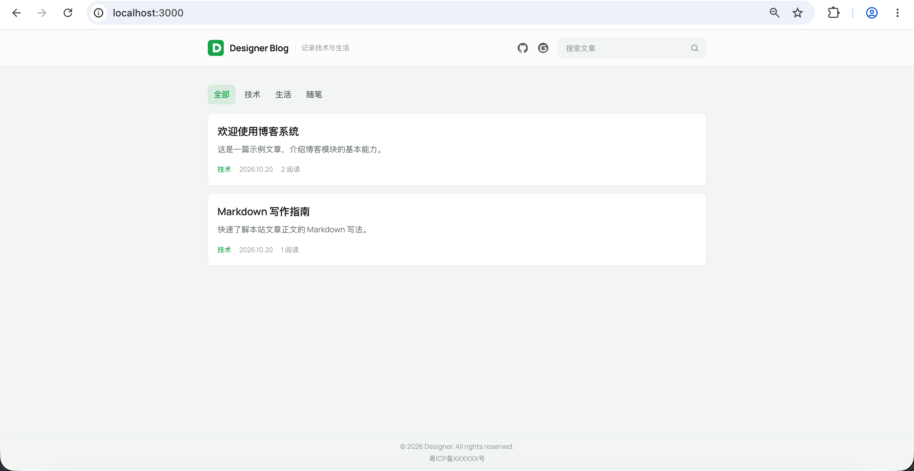
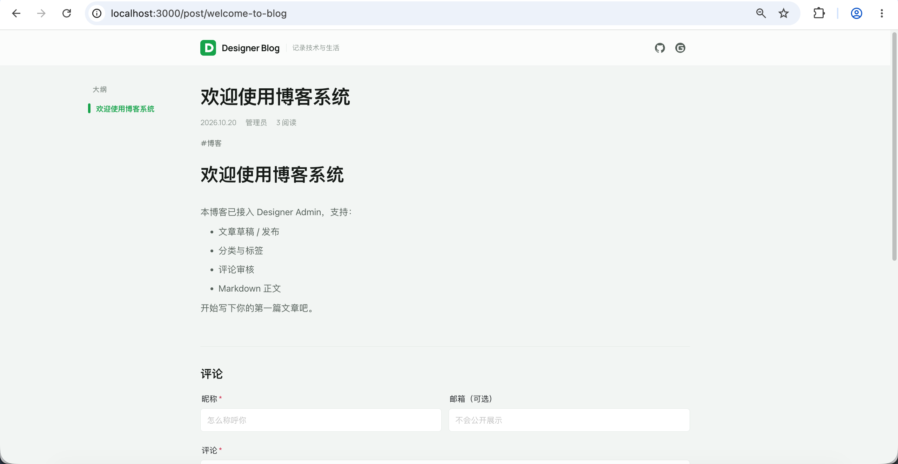
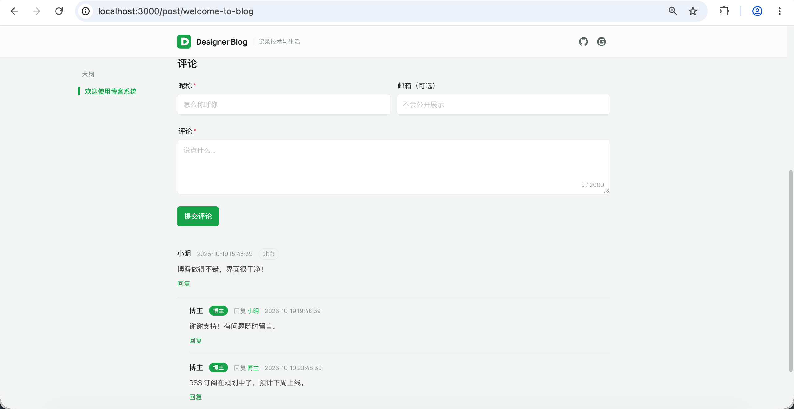
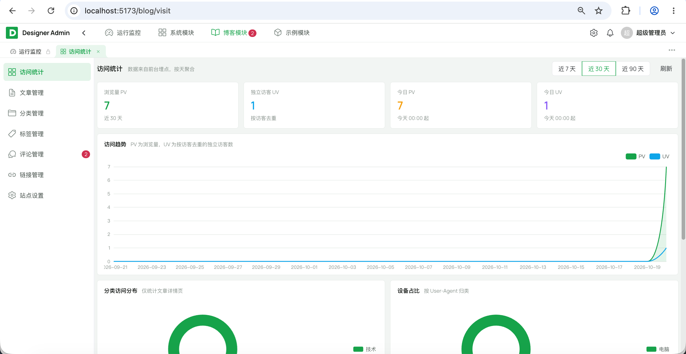
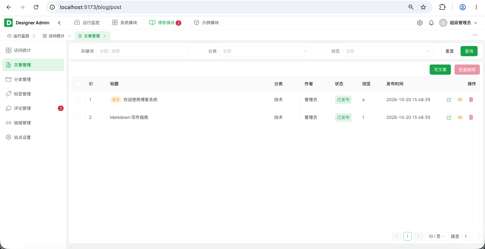
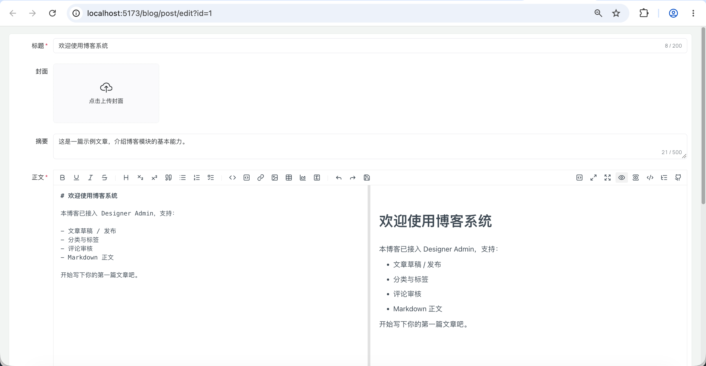
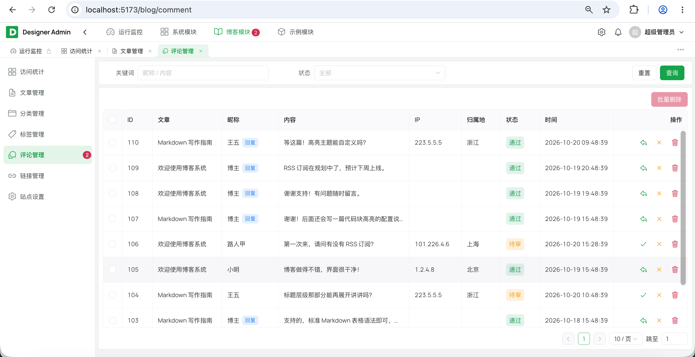
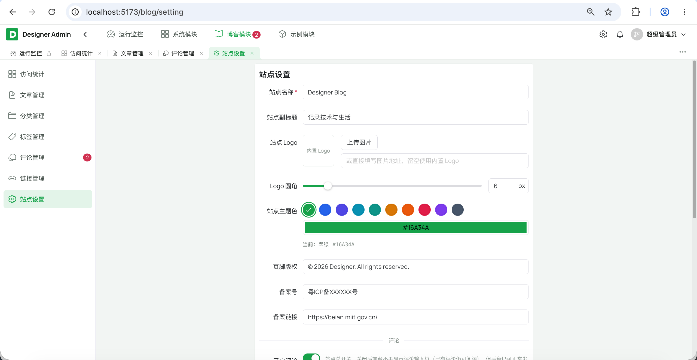

# Designer Blog

[](LICENSE)
[](https://adoptium.net/temurin/releases/)
[](https://solon.noear.org/)
[](https://vuejs.org/)
[](https://nuxt.com/)

## 简介

一套**前后台分离**的个人博客系统，基于 **[Designer Admin](https://gitee.com/rainterm/designer-admin)** 后台脚手架开发：

- **博客前台**（`designer-ui/blog-web`）：Nuxt 4 SSR，面向读者与搜索引擎，正文随首屏 HTML 返回；
- **管理后台**（`designer-ui/admin-web/src/modules/blog`）：在脚手架提供的登录、权限、日志、任务与文件存储之上管理博客内容；
- **后端**：博客业务作为独立模块 `designer-module-blog` 接入，只依赖 `designer-common` / `designer-framework`，由 `designer-server` 装配。

登录、RBAC、文件存储、操作日志、定时任务等基础能力均来自脚手架，本项目**不重复实现**，也不修改脚手架既有能力。

功能范围：文章 / 分类 / 标签 / 评论 / 个人链接 / 站点设置 / 访问统计，外加 SEO 所需的 `sitemap.xml`、`robots.txt` 与真 404。

**为什么前台用 SSR**

1. **搜索引擎收录**：百度等对 JS 渲染的抓取能力弱，纯客户端渲染的文章常常长时间不被收录。
2. **分享卡片不为空**：微信 / QQ / Twitter / Facebook / Slack 的爬虫**完全不执行 JS**，只能读到首屏 HTML 里的 `og:*`；没有 SSR 就只剩一张没有标题与缩略图的白卡片。
3. **真正的 404**：slug 不存在时返回 HTTP 404，而不是「200 + 空壳」——后者会被搜索引擎当成正常页收录，浪费抓取配额。

代价是多一个 Node 常驻进程（基线约 100–200MB），因此 SSR 页面在 nginx 层缓存 60 秒，命中时完全不经过 Node。

## 界面预览

### 博客前台







### 管理后台











## 功能特性

| 模块 | 能力 |
|---|---|
| 内容管理 | Markdown 文章、草稿 / 发布、置顶、分类与标签、个人链接、站点设置 |
| 评论 | 匿名评论、两级开关、默认待审、验证码 + 频控防刷、置顶与博主回复 |
| 访问统计 | 服务端推导的埋点、五类图表、去重与配额、定期清理 |
| SEO | 页面级 meta / OG / JSON-LD、`sitemap.xml`、`robots.txt`、真 404 |
| 阅读数 | Redis 累加 + 定时合并回写，读路径不产生数据库写 |

### 内容管理

- **文章**：Markdown 正文（`md-editor-v3`），草稿 / 发布两态，`slug` 即前台地址 `/post/{slug}`；支持置顶，管理端可按标题 / 正文关键字与分类 / 标签 / 状态筛选，前台顶栏另有搜索（`?q=`）。
- **分类与标签**：一篇文章一个分类、多个标签（`blog_post_tag`），两者都有独立前台页 `/category/{slug}`、`/tag/{slug}`；列表页的标签查询固定 2 条，避免按篇数放大请求。
- **个人链接**：站长的社交 / 外部链接（GitHub、Gitee、邮箱等），后台维护名称、图标、排序与启停；前台页头以一行图标展示，点击新开标签页。
- **站点设置**：站点名 / 副标题 / Logo（含圆角）/ 页脚版权 / 备案号 / 站长署名 / 保留昵称 / SEO 描述与关键词 / 主题色，一处配置前台全站生效；页脚版权留空则整块不渲染。
- **阅读数**：读路径只写 Redis（`HINCRBY`），`BlogViewFlushJob` 每 30 秒合并回写 MySQL，并用 Redis 锁保证多实例只回写一次；展示值 = 库里已落库 + 未回写增量。

### 评论

- **匿名评论**：读者无需注册；提交默认**待审**，后台审核通过才公开。
- **防刷三层**：滑块验证码（AJ-Captcha，一次性凭据）+ 分 IP 频控（`@RateLimit`：30 秒 1 条、24 小时 20 条）+ 默认待审。
- **两级开关**：站点总开关（站点设置）与单篇「允许评论」为**与**关系，都开启才可评论；关闭后已发布评论仍可读。
- **回复层级压平为 2 层**：存储上 `parent_id` 记录真实回复对象（链可任意深），展示层统一上溯到顶级评论，最多两层，第二层标出「某某 回复 某某」。
- **我的评论**：读者凭浏览器本地密钥（请求头 `X-Commenter-Key`，服务端只存 SHA-256）查看自己的待审评论、删除自己的评论。
- **后台运营**：审核（通过 / 拒绝）、批量删除、置顶、博主回复（`author_type=1`，署名固定取站点设置里的站长署名）；待审批数量在侧栏菜单上以红点提示。
- **防冒充**：保留昵称可配（默认 `博主,站长,管理员,admin`），访客昵称包含其中任一词即拒绝；博主回复不接受昵称入参。
- **IP 归属地**：离线 ip2region 解析到**省级**，前台与后台均展示，不向第三方泄露访客 IP。

### 访问统计

前台每次路由切换上报一次埋点，后台「访问统计」页聚合成图表。

- **埋点只接收路径**：IP / UA / 来源 / 设备 / 页面归属分类**全部由服务端从请求推导**，前端无法伪造统计。
- **五类图表**：PV / UV 趋势（按天补齐空缺日期）、分类访问分布、来源 Top、设备占比、访客地域分布（Top 10 省份）。
- **防刷与去重**：同访客同路径 60 秒去重、单 IP 每日 3000 条上限，超限静默丢弃。
- **日志清理**：内置任务 `blogLogTask.cleanVisitLog(90)`（默认暂停），保留 90 天。

### SEO

- `app/composables/useBlogSeo.js` 是页面级 SEO 的唯一入口：`title` / `description` / `keywords` / `og:*` / `twitter:*` / `canonical` / JSON-LD（文章页为 `BlogPosting`）。
- `canonical` 保留 `?page=`、剥掉 `?q=`：分页是不同内容必须收录，搜索词组合必须收敛。
- `server/routes/` 动态生成 `/robots.txt` 与 `/sitemap.xml`（首页 + 分类 + 标签 + 全部已发布文章），绝对地址由请求的 `Host` / `X-Forwarded-Proto` 推导，**改域名不用改代码**。
- slug / 分类不存在时抛 `BizException(NOT_FOUND)`，前台返回真正的 HTTP 404。

## 设计

### 技术栈

| 层 | 选型 | 版本 | 说明 |
|---|---|---|---|
| 运行时 | JDK | 25 | 脚手架要求 |
| 后端框架 | Solon | 4.1.0 | 来自脚手架 |
| ORM | MyBatis-Plus（Solon 插件） | 3.5.17 | 来自脚手架 |
| 多表查询 | MyBatis-Plus-Join | 1.5.9 | 来自脚手架 |
| 鉴权 | Sa-Token | 1.46.0 | 来自脚手架，后台登录与接口权限 |
| 数据库 | MySQL | 8.0.13+ | 表结构依赖 8.0.13 起支持的函数索引 |
| 缓存 / 会话 | Redis | 7 | 会话、验证码、限流、阅读数、公开接口缓存 |
| IP 归属地 | ip2region（离线 xdb） | 2.7.0 | 不请求第三方，不泄露访客 IP |
| 博客前台 | Nuxt | 4.6 | SSR 直出，页面与接口同源 |
| 管理后台 | Vue + Naive UI | 3.5 / 2.45 | 来自脚手架 |
| 构建 | Nitro / Vite | 随 Nuxt / 8 | 前台产物是 Node 服务 |
| Markdown | md-editor-v3 | 7 | 后台编辑、前台渲染共用一套语法与样式 |
| 图表 | ECharts | 5.6 | 访问统计 |

> `md-editor-v3` 底层依赖 Vditor 的运行时资源（lute 引擎 / 代码高亮 / 图标 / 语言包），默认从 unpkg 动态拉取。
> 后台的 Vite 插件（`plugins/copyVditorAssets.js`）在启动 / 构建时把这些资源复制到 `public/vditor`，
> 编辑器因此**不依赖外部 CDN**。

### 目录结构

```
designer-blog/
├── designer-module-blog/           # 博客业务模块
│   ├── blog-api/                   #   ★ 对外契约（当前按需预留）
│   └── blog-service/               #   文章 / 分类 / 标签 / 评论 / 链接 / 设置 / 统计
├── designer-ui/
│   ├── blog-web/                   # ★ 博客前台（Nuxt 4 SSR）
│   ├── admin-web/
│   │   └── src/modules/blog/       # ★ 后台博客页面：文章 / 分类 / 标签 / 评论 / 链接 / 设置 / 统计
│   └── shared/captcha/             # ★ 前后台共用的滑块验证码源码
├── designer-server/
│   └── src/main/resources/
│       ├── app.yml                 #   博客配置（验证码、限流、缓存等）
│       └── ip2region.xdb           #   IP 归属地离线数据（约 11MB，随包）
├── sql/
│   ├── init/mysql/
│   │   ├── 00-run-init.sh          #   入口：_base → system → demo → blog → upgrade
│   │   └── blog/                   #   ★ 博客表结构与种子数据
│   └── upgrade/mysql/              #   增量升级脚本（V{版本}__{说明}.sql，幂等）
├── deploy/                         # 三容器部署（server + 博客 Node + nginx）
├── docs/                           # 开发规范、SSO
└── designer-common/ · designer-framework/ · designer-module-system/ · designer-module-demo/
                                    # 脚手架模块，与上游保持一致
```

### 文档说明

| 文档                                 | 说明                                 |
| ------------------------------------ | ------------------------------------ |
| [deploy/README.md](deploy/README.md) | 三容器部署、域名分流、SSR 缓存与限流 |
| [docs/开发规范.md](docs/开发规范.md) | 脚手架的前后端编码约定与模块依赖方向 |

### 博客设计

#### 性能与缓存

- **SSR 页面缓存在 nginx 层**：`proxy_cache` 缓存整段 HTML，TTL 60 秒，命中时完全不走 Node；缓存键含 `$host`，404 也缓存，冷 URL 并发只回源一次。
- 公开读接口（站点设置 / 分类 / 标签 / 外链）在应用层有 1 小时缓存，写侧主动失效，后台改完立刻生效。
- 阅读数读路径只碰 Redis，30 秒合并回写，热文章不会产生行锁竞争。
- `PostCard` 关闭 Nuxt 链接预取（`:prefetch="false"`）：首页 5 张卡片不值得提前发 5 次请求。
- 读路径限流全部在 nginx（页面 60r/m、`/app-api/` 120r/m、sitemap 6r/m），被拦下的请求不消耗 Node 与数据库连接。

#### 图片压缩

上传图片在服务端落盘前按**存储配置**压缩

开关在**系统管理 → 存储配置 → 编辑 →「图片压缩」**

| 格式 | 行为 |
|---|---|
| JPEG | 有损重编码，质量参数生效 |
| PNG | 无损重编码，质量参数**无效**（固定最高 deflate 级别） |
| GIF / WebP / AVIF / SVG / ICO | 跳过：动图重编码只剩第一帧，其余 JDK ImageIO 不支持编码 |

#### 图片缓存

文件名是 UUID、内容不会被原地覆盖，因此「URL 不变 ⇒ 内容不变」，公开图直接给强缓存：

| 访问类型 | `Cache-Control` | 效果 |
|---|---|---|
| 公开 | `public, max-age=31536000, immutable` | 浏览器一年内不发请求（刷新也不协商），nginx / CDN 可长期缓存 |
| 私有 | `private, no-store` | 不落盘：共用电脑换个账号也读不到上一个账号的图 |

**关键点在写入位置**。同一个公开文件有两条到达浏览器的方式，必须都覆盖：

1. 走代理下载接口（`/app-api/system/file/download/**`）—— 我们直接写响应头；
2. 存储配置填了「公网 / CDN 前缀」时，下发的是**直链**，浏览器与边缘节点根本不经过后端，响应头怎么写都没用 —— 所以在上传时把同样的值写进对象元数据（`PutObject` 的 `Cache-Control`），由对象存储当响应头返回。

两处共用 `StorageCachePolicy` 一个常量，避免「直连 CDN 缓存一年、走代理每次回源」这类分叉。

落地时注意四点：

- **CDN 需开启「遵循源站缓存头」**，否则会按自己的默认 TTL 覆盖；
- 用 CDN 回源到应用（本地存储）时，响应里的 `SOLONID` Cookie 会让多数 CDN 拒绝缓存，这种组合建议让 CDN 直接指向对象存储；
- CDN 域名不要与站点主域相同：公开 SVG 走直链时由 CDN 决定 Content-Type，同源下等同于可执行的 XSS；不同域则 `` 天然安全。

#### 主题

主题色由后台「站点设置」下发，前台据此覆盖品牌配色；`scripts/syncThemeTokens.js` 与 `scripts/syncBrandMark.js` 在构建期把主题变量与 favicon 同步到静态资源，换主题 / 换 Logo 不需要改代码。

## 快速开始（本地开发）

### 0. 环境要求

| 组件 | 版本 | 说明 |
|---|---|---|
| JDK | 25+ | 后端编译与运行（`maven.compiler.release=25`） |
| Maven | 3.9+ | 后端构建 |
| Node.js | 18+（推荐 22） | 前端构建 |
| pnpm | 10.x | 前端包管理（`packageManager: pnpm@10.33.0`） |
| MySQL | 8.0.13+ | 数据库（唯一索引用函数索引实现「仅约束未删除行」） |
| Redis | 7 | 会话、验证码、限流、阅读数（**必需**） |

一键检查 / 安装：

```bash
cd deploy
./install-env.sh --check   # 仅检查
./install-env.sh           # 按需安装（Linux 建议 sudo）
```

### 1. 准备 MySQL 与 Redis

连接信息在 `designer-server/src/main/resources/app.yml`，支持环境变量覆盖：

- MySQL：`DB_HOST` / `DB_PORT` / `DB_USER` / `DB_PASSWORD` / `DB_NAME`（默认库 `designer_blog`）
- Redis：`REDIS_HOST` / `REDIS_PORT` / `REDIS_PASSWORD` / `REDIS_DB`

本地也可以只起数据库：

```bash
cd deploy
cp .env.example .env
./deploy-db.sh        # MySQL + Redis，不自动建表
```

### 2. 初始化数据库

> 脚本为**破坏性初始化**（`DROP TABLE` 重建 + 插入种子数据），仅首次或需要重置时执行，勿对有数据的库重复运行。

```bash
# 交互式：按提示输入连接信息，回车使用默认值
bash sql/init/mysql/00-run-init.sh

# 免交互（CI / 脚本）
DB_HOST=127.0.0.1 DB_PORT=3306 DB_USER=root DB_PASSWORD=root DB_NAME=designer_blog \
  bash sql/init/mysql/00-run-init.sh
```

导入顺序为 `_base → system → demo → blog → upgrade`；博客表结构与种子数据在 `sql/init/mysql/blog/`，老库增量变更为 `sql/upgrade/mysql/`（幂等，初始化时会再跑一遍兜底）。

### 3. 启动后端

在 IDE 中运行 `com.designer.admin.DesignerApp`（模块 `designer-server`），或命令行：

```bash
# 仓库根目录
mvn -pl designer-server -am -DskipTests clean package
java -jar designer-server/target/designer-server.jar
```

启动后：

- 管理端 API：`http://localhost:8080/admin-api`
- 博客公开接口：`/app-api/blog/public/**`
- 健康检查：`GET http://localhost:8080/admin-api/system/health`
- 接口文档：`http://localhost:8080/doc.html`

### 4. 启动前端

> 需要 pnpm：`corepack enable pnpm` 或 `npm i -g pnpm`。

```bash
# 管理后台 → http://localhost:5173
cd designer-ui/admin-web
pnpm install
pnpm run dev

# 博客前台（Nuxt SSR） → http://localhost:3000
cd designer-ui/blog-web
pnpm install
pnpm run dev
pnpm run build     # 产出 .output/（Node 服务，不是静态站点）
```

管理后台把 `/admin-api`、`/app-api` 代理到 `http://localhost:8080`。
博客前台不用代理：浏览器侧走同源相对路径 `/app-api`，**SSR 期间由 Node 直连后端**，地址读 `.env` 的 `NUXT_API_INTERNAL_BASE`（默认 `http://localhost:8080`）。

### 默认账号

**注意**：以下为初始化种子数据中的演示账号，仅用于本地体验；部署到生产环境前请务必修改密码或删除该账号。

| 账号 | 密码 | 角色 |
|---|---|---|
| admin | admin123 | 超级管理员（全部权限） |
| guest | guest123 | 普通用户（只读示例） |

## 生产部署

数据库与应用**分开部署**：本机用 JDK / Maven / Node 打包，再构建运行镜像。
应用共三个容器 —— 后端 Server、博客前台 Node（Nuxt SSR）、入口 Nginx；
入口 Nginx 按域名分流：博客域名反代到 Node，后台域名发静态文件。

### 部署流程

```bash
cd deploy

# 1. 检查并按需安装环境（Docker / JDK 25 / Maven / Node）
./install-env.sh

# 2. 配置环境变量
cp .env.example .env
vim .env

# 3. 启动 MySQL + Redis（不自动建表）
./deploy-db.sh

# 4. 首次 / 重置时初始化数据库
(cd .. && bash sql/init/mysql/00-run-init.sh)

# 5. 本地打包 + 构建镜像 + 启动 Server / 博客前台 / 入口 Nginx
./deploy-app.sh
```

可选：`./deploy-minio.sh` 启动本地 MinIO（S3 兼容存储，API `9000` / Console `9001`）。

### 常用命令

| 命令 | 说明 |
|---|---|
| `./install-env.sh` | 检查并安装环境（`--check` 仅检查） |
| `./deploy-db.sh` | 启动 MySQL、Redis（不自动建表） |
| `./deploy-minio.sh` | 启动本地 MinIO（可选） |
| `./deploy-app.sh` | 本地打包并部署三个容器 |
| `./deploy-app.sh --skip-build` | 跳过打包，复用 `deploy/build` 已有产物 |
| `./restart.sh app` / `./stop.sh app` | 重启 / 停止应用（三个容器一起） |
| `./logs.sh server` / `blog` / `web` | 查看后端 / 前台 Node / Nginx 日志 |

### 访问入口

| 入口 | 默认端口 | 说明 |
|---|---|---|
| 博客前台 | `WEB_PORT=80` | `http://www.rainterm.cn`（Nuxt SSR，正文随首屏 HTML 返回） |
| 管理后台 | `WEB_PORT=80` | `http://admin.rainterm.cn` |
| sitemap | `WEB_PORT=80` | `http://www.rainterm.cn/sitemap.xml` |
| 后端 API | `SERVER_PORT=8080` | 仅绑定 `127.0.0.1`，不直接对外，统一经 Nginx |

域名在 `deploy/nginx/default.conf` 的 `server_name` 中定义，端口在 `.env` 的 `WEB_PORT` 中配置；
未匹配到 `server_name` 的请求（例如直接访问 IP）落到博客站点，而不是暴露管理后台。完整说明见 [deploy/README.md](deploy/README.md)。

### 运维要点

- 日常发版只执行 `./deploy-app.sh`，不必动数据库；数据库表需手动初始化，增量升级脚本按版本执行并登记，禁止重跑破坏性脚本。
- 上传文件在 `server_uploads` 卷，升级 / 迁移时需与数据库一起备份。
- 修改 `.env` 中的默认密码，并为 MySQL / Redis 配置强密码；本机库时 `DB_PASSWORD` 与 `MYSQL_ROOT_PASSWORD` 保持一致。
- 多实例部署时：会话、验证码、限流、阅读数与公开接口缓存共用 Redis，博客 Node 可横向扩容（SSR 缓存仍在 nginx）。
- 博客前台容器**不发布端口**，只能经 nginx 访问；否则可绕过 nginx 直连并伪造 `X-Real-IP`。
- 前面再加 CDN 时，需在 nginx 用 `real_ip` / `set_real_ip_from` 还原真实 IP，否则限流会按 CDN 节点统计并误伤全站。
